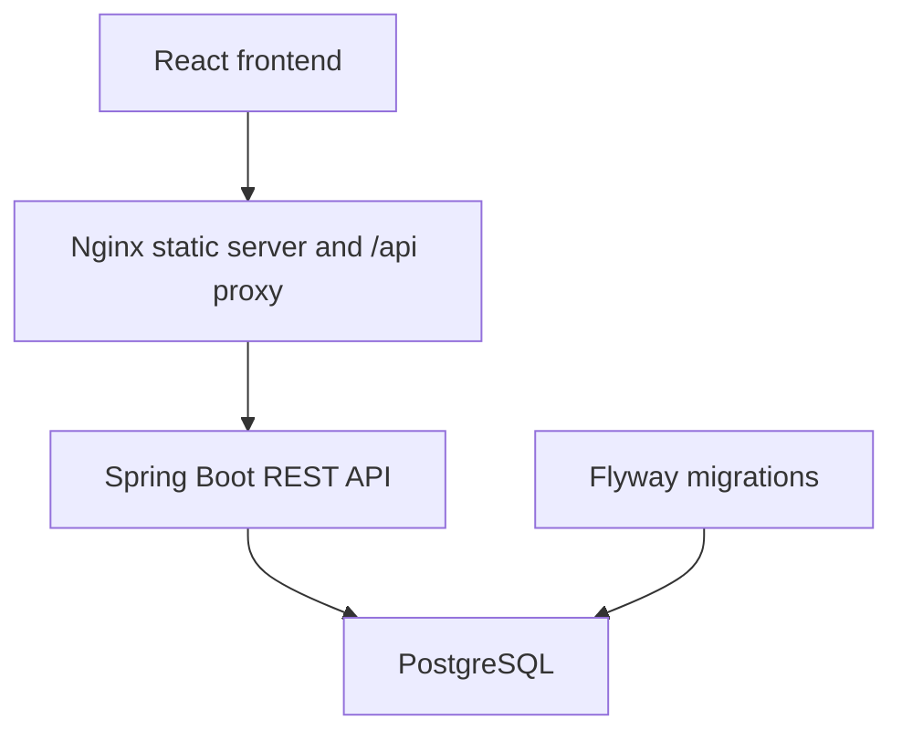

# Hockeylån

Hockeylån is a web application for managing loans of hockey equipment within a club or similar organisation.

The application provides equipment administration, QR-code-assisted equipment identification, administrator-controlled loan registration, returns, active-loan monitoring and searchable loan history.

The user interface is currently written in Swedish, while this project documentation is maintained in English.

## Project overview

Hockeylån helps a club keep track of hockey equipment such as complete kits, helmets, skates and sticks.

Each equipment item has a unique serial number and can have a generated QR code. An authorised administrator can scan or open the QR code, verify the equipment, enter the borrower's contact information and register the loan.

The application is not designed as an unattended public lending service. Loan registration, QR administration, the scanner page and all equipment-management functions require an authenticated administrator session.

## Current functionality

The current application supports:

- Session-based administrator authentication.
- One-time creation of the initial administrator.
- CSRF protection for state-changing requests.
- Equipment creation and editing.
- Equipment activation and deactivation.
- Equipment availability tracking.
- Equipment search and filtering.
- The following equipment types:
    - `COMPLETE_KIT`
    - `HELMET`
    - `SKATES`
    - `STICK`
- The following condition values:
    - `NEW`
    - `GOOD`
    - `WORN`
    - `NEEDS_REPAIR`
- Optional age categories:
    - `CHILD`
    - `JUNIOR`
    - `SENIOR`
- Optional size, brand, model, storage location and description fields.
- QR-code generation for equipment.
- QR-code scanning through the browser camera.
- Administrator-controlled loan registration.
- Required expected return dates.
- Prevention of more than one active loan for the same equipment.
- Return registration with a return timestamp.
- Optimistic-locking and database safeguards for concurrent operations.
- Active, overdue and returned loan states derived from loan data.
- Paginated and filterable loan history.
- Structured API errors and validation errors.
- Request payload limits.
- In-memory API and login rate limiting.
- Responsive frontend views.
- Backend integration and security tests.
- Frontend component, page and API tests.
- GitHub Actions continuous integration.

## Architecture overview

The application uses a conventional three-tier architecture:



The frontend is a React single-page application. In the containerised setup, Nginx serves the compiled frontend and proxies `/api` requests to the backend.

The Spring Boot backend contains REST controllers, DTOs, services, repositories, domain entities, security filters and shared exception handling.

PostgreSQL stores administrators, equipment and loans. Flyway is the sole owner of schema evolution, while Hibernate validates that the entity mappings match the migrated schema.

## Technology stack

Versions below are taken from the repository's Maven configuration, npm lockfile, Dockerfiles, Compose files and CI workflow.

| Area | Technology | Repository version |
|---|---|---:|
| Backend language | Java | 21 |
| Backend framework | Spring Boot | 4.0.6 |
| Build tool | Maven Wrapper | Wrapper included in repository |
| Persistence | Spring Data JPA and Hibernate | Managed by Spring Boot 4.0.6 |
| Security | Spring Security | Managed by Spring Boot 4.0.6 |
| Database migration | Flyway | Managed by Spring Boot 4.0.6 |
| QR generation | ZXing Core and Java SE | 3.5.3 |
| Database | PostgreSQL Compose image | 17.10-alpine3.24 |
| Test database | PostgreSQL Testcontainers image | 17-alpine |
| Backend integration tests | Testcontainers | Managed by Spring Boot 4.0.6 |
| Frontend runtime | React | 19.2.8 |
| Routing | React Router | 8.3.0 |
| HTTP client | Axios | 1.18.1 resolved in `package-lock.json` |
| QR scanning | html5-qrcode | 2.3.8 |
| Styling | Tailwind CSS | 4.3.0 resolved in `package-lock.json` |
| Frontend build | Vite | 8.1.5 resolved in `package-lock.json` |
| Frontend tests | Vitest | 4.1.6 |
| Linting | ESLint | 10.3.0 |
| CI Node.js | Node.js | 24 |
| Frontend build image | Node.js | 22-alpine |
| Frontend web server | Nginx | 1.30.4-alpine |
| Backend runtime image | Eclipse Temurin JRE | 21-alpine |

Dependencies without an explicit version in `pom.xml` are version-managed by the Spring Boot 4.0.6 dependency management configuration.

## Repository structure

```text
.
├── .github/
│   └── workflows/
│       └── ci.yml
├── .mvn/
│   └── wrapper/
├── frontend/
│   ├── public/
│   ├── src/
│   │   ├── api/
│   │   ├── auth/
│   │   ├── components/
│   │   ├── features/
│   │   ├── pages/
│   │   ├── test/
│   │   └── utils/
│   ├── Dockerfile
│   ├── nginx.conf
│   ├── package.json
│   └── vite.config.js
├── src/
│   ├── main/
│   │   ├── java/com/norops/hockeylan/
│   │   │   ├── config/
│   │   │   ├── controller/
│   │   │   ├── dto/
│   │   │   ├── exception/
│   │   │   ├── mapper/
│   │   │   ├── model/
│   │   │   ├── repository/
│   │   │   ├── security/
│   │   │   ├── service/
│   │   │   └── util/
│   │   └── resources/
│   │       └── db/migration/
│   └── test/
├── .env.example
├── .env.prod.example
├── docker-compose.yml
├── docker-compose.prod.yml
├── docker-compose.server.yml
├── Dockerfile
├── pom.xml
├── mvnw
└── mvnw.cmd
```

## Prerequisites

### Docker-based development

Install:

- Docker Engine or Docker Desktop.
- Docker Compose v2.
- Git.

The Docker-based setup does not require a locally installed Java, Maven, Node.js or PostgreSQL runtime.

### Development without application containers

Install:

- Java 21.
- PostgreSQL 17 or a compatible PostgreSQL installation.
- Node.js 24, matching the CI environment.
- npm.
- Git.

Maven does not need to be installed globally because the repository contains Maven Wrapper scripts.

### Backend integration tests

A Docker-compatible container runtime must be available because several backend tests start PostgreSQL through Testcontainers.

## Environment variables

Copy `.env.example` to `.env` for local Docker development:

```bash
cp .env.example .env
```

On Windows PowerShell:

```powershell
Copy-Item .env.example .env
```

Replace the example database password before starting the application.

### Core configuration

| Variable | Required | Default | Purpose |
|---|---:|---|---|
| `SERVER_PORT` | No | `8080` | Backend HTTP port when running outside Compose. |
| `BACKEND_PORT` | No | `8080` | Host port for the backend in local Compose. |
| `FRONTEND_PORT` | No | `5173` | Host port for the frontend Nginx container. |
| `SPRING_PROFILES_ACTIVE` | Recommended outside Compose | No explicit default | Selects `dev`, `prod` or `test`. Compose sets `dev` locally and `prod` in the production override. |
| `DB_HOST` | No locally | `localhost` | PostgreSQL host. |
| `DB_PORT` | No | `5432` | PostgreSQL port. |
| `DB_NAME` | No locally | `hockeylan` | PostgreSQL database name. |
| `DB_USERNAME` | No locally | `hockeylan` | PostgreSQL username. |
| `DB_PASSWORD` | Yes | None | PostgreSQL password. |
| `CORS_ALLOWED_ORIGINS` | No locally; required by production Compose | `http://localhost:5173` | Comma-separated browser origins allowed to make credentialed CORS requests. Wildcards must not be used. |
| `QR_BASE_URL` | No locally; required by production Compose | `http://localhost:5173` | Public frontend base URL embedded in generated QR links. |
| `VITE_API_BASE_URL` | No | `/api` | API base URL embedded in the frontend build. |
| `APP_TIME_ZONE` | No | `Europe/Stockholm` | JVM and application time zone supplied through `JAVA_TOOL_OPTIONS` in the production override. |
| `ADMIN_SESSION_TIMEOUT` | No | `30m` | Administrator HTTP-session lifetime. |
| `MAX_JSON_PAYLOAD_BYTES` | No | `65536` | Maximum accepted JSON request size. |

`VITE_*` variables are compiled into the browser bundle. Never place passwords, tokens or other secrets in them.

### Rate-limiting configuration

| Variable | Default |
|---|---:|
| `RATE_LIMIT_ENABLED` | `true` |
| `RATE_LIMIT_API_CAPACITY` | `120` |
| `RATE_LIMIT_API_REFILL_TOKENS` | `120` |
| `RATE_LIMIT_API_REFILL_PERIOD_SECONDS` | `60` |
| `RATE_LIMIT_LOGIN_CAPACITY` | `5` |
| `RATE_LIMIT_LOGIN_REFILL_TOKENS` | `5` |
| `RATE_LIMIT_LOGIN_REFILL_PERIOD_SECONDS` | `300` |
| `RATE_LIMIT_IDLE_ENTRY_TTL_SECONDS` | `900` |
| `RATE_LIMIT_MAX_ENTRIES` | `10000` |

The implementation is in-memory and therefore applies independently to each backend application instance.

### Initial administrator variables

These variables must only be supplied during the one-time administrator bootstrap:

| Variable | Required during bootstrap | Purpose |
|---|---:|---|
| `ADMIN_BOOTSTRAP_ENABLED` | Yes | Must be `true` to activate the bootstrap runner. |
| `ADMIN_BOOTSTRAP_USERNAME` | Yes | Username for the initial administrator. |
| `ADMIN_BOOTSTRAP_PASSWORD` | Yes | Initial password. Must contain between 12 and 200 characters. |

Do not store real administrator credentials in committed environment files.

## Local development

### Recommended hybrid setup

A convenient development workflow is to run PostgreSQL in Docker while running the backend and frontend directly from the source tree.

Create `.env`:

```bash
cp .env.example .env
```

Start only PostgreSQL:

```bash
docker compose up -d hockeylan-postgres
```

Start the backend with the development profile:

```bash
./mvnw spring-boot:run -Dspring-boot.run.profiles=dev
```

On Windows PowerShell:

```powershell
.\mvnw.cmd spring-boot:run "-Dspring-boot.run.profiles=dev"
```

The backend is then available at:

```text
http://localhost:8080
```

In a second terminal, start the frontend:

```bash
cd frontend
npm ci
npm run dev
```

The Vite development server is available at:

```text
http://localhost:5173
```

When the `dev` profile is active, `DataSeeder` adds four development equipment records if their serial numbers do not already exist:

- `HL-DEV-001`
- `SK-DEV-001`
- `ST-DEV-001`
- `KIT-DEV-001`

The seeder does not create an administrator.

## Start via Docker Compose

Create the local environment file and set a local database password:

```bash
cp .env.example .env
```

Build and start the complete application:

```bash
docker compose up -d --build
```

Check container health:

```bash
docker compose ps
```

View logs:

```bash
docker compose logs -f
```

View logs for one service:

```bash
docker compose logs -f hockeylan-backend
```

The local services are exposed at:

| Service | Address |
|---|---|
| Frontend | `http://localhost:5173` |
| Backend | `http://localhost:8080` |
| PostgreSQL | `localhost:5432` |

The Compose ports are bound to `127.0.0.1`, so they are not directly exposed on every host network interface.

Stop the application:

```bash
docker compose down
```

Stop the application and permanently remove the local PostgreSQL volume:

```bash
docker compose down -v
```

The `-v` command deletes the local database data. Use it only when a complete reset is intended.

## Production deployment on the homelab server

The target host is an Ubuntu Server machine named `homelab`. The repository is deployed under:

```text
/home/hading/homelab/stacks/hockeylan
```

Persistent PostgreSQL data and database backups are stored outside the repository under:

```text
/mnt/storage/hockeylan/postgres
/mnt/storage/hockeylan/backups
```

The production deployment uses all three Compose files in this order:

```bash
docker compose \
  --env-file .env.prod \
  -f docker-compose.yml \
  -f docker-compose.prod.yml \
  -f docker-compose.server.yml \
  up -d --build
```

Always use the same file order for `config`, `build`, `up`, `ps`, `logs`, `exec`, `run` and `down` commands. Later files intentionally override earlier files.

Validate the merged configuration before starting or changing the stack:

```bash
docker compose \
  --env-file .env.prod \
  -f docker-compose.yml \
  -f docker-compose.prod.yml \
  -f docker-compose.server.yml \
  config --quiet
```

The production configuration:

- Activates the `prod` Spring profile.
- Requires explicit PostgreSQL credentials, CORS origins and the public QR base URL.
- Uses `APP_TIME_ZONE=Europe/Stockholm` through `JAVA_TOOL_OPTIONS`.
- Publishes no host ports for PostgreSQL, the backend or the frontend.
- Uses a dedicated PostgreSQL 17.10 container; it does not reuse other PostgreSQL containers on the host.
- Replaces the named development database volume with `/mnt/storage/hockeylan/postgres`.
- Requires the PostgreSQL host directory to exist because `create_host_path` is disabled.
- Keeps the backend filesystem read-only and supplies `/tmp` through a restricted `tmpfs` mount.
- Drops all Linux capabilities from the backend and enables `no-new-privileges`.
- Uses `restart: unless-stopped` for all three services after the server override is applied.

### Docker networks and Nginx Proxy Manager

The merged server configuration uses two Docker networks:

| Network | Type | Connected services | Purpose |
|---|---|---|---|
| `hockeylan-internal` | Internal bridge (`internal: true`) | PostgreSQL, backend and frontend | Private communication inside the Hockeylån stack. |
| `homelab_net` | Existing external bridge | Frontend and Nginx Proxy Manager | Allows the host reverse proxy to reach the frontend. |

PostgreSQL and the backend must not join `homelab_net`. Only `hockeylan-frontend` is connected to both networks.

Nginx Proxy Manager must forward the public host to:

```text
hockeylan-frontend:80
```

The public application address is:

```text
https://bkflagg.norops.se
```

Nginx Proxy Manager terminates TLS. The frontend Nginx container serves the React application and forwards `/api` to `hockeylan-backend:8080` across `hockeylan-internal`.

Production values must include:

```dotenv
CORS_ALLOWED_ORIGINS=https://bkflagg.norops.se
QR_BASE_URL=https://bkflagg.norops.se
VITE_API_BASE_URL=/api
APP_TIME_ZONE=Europe/Stockholm
```

Keep the real `.env.prod` protected and uncommitted. Never display or commit its database or administrator credentials.

### PostgreSQL bind mount

The PostgreSQL container stores its data at `/var/lib/postgresql/data`, backed by this host path:

```text
/mnt/storage/hockeylan/postgres
```

The directory must exist and have an owner and permissions compatible with the PostgreSQL container before the stack starts. Do not create or change those permissions without first confirming the effective PostgreSQL container user and the intended host ownership.

The backup directory is deliberately not mounted inside the database container. Backup streams are written from `docker compose exec` directly to the protected host directory.

### Database backup

Create the backup directory before using this procedure and restrict access to authorised operators. From the deployed repository directory, create a custom-format backup without printing credentials:

```bash
backup_timestamp="$(date +%Y%m%d_%H%M%S)"

docker compose \
  --env-file .env.prod \
  -f docker-compose.yml \
  -f docker-compose.prod.yml \
  -f docker-compose.server.yml \
  exec -T hockeylan-postgres \
  sh -c 'pg_dump -U "$POSTGRES_USER" -d "$POSTGRES_DB" -Fc' \
  > "/mnt/storage/hockeylan/backups/hockeylan_${backup_timestamp}.dump"
```

Verify that the resulting file exists, is non-empty and is recognised as a PostgreSQL custom-format archive:

```bash
test -s "/mnt/storage/hockeylan/backups/hockeylan_${backup_timestamp}.dump"

docker compose \
  --env-file .env.prod \
  -f docker-compose.yml \
  -f docker-compose.prod.yml \
  -f docker-compose.server.yml \
  exec -T hockeylan-postgres \
  pg_restore --list \
  < "/mnt/storage/hockeylan/backups/hockeylan_${backup_timestamp}.dump" \
  > /dev/null
```

Protect backup files as production data because they contain administrator records and borrower personal information. Copy backups to a separate failure domain according to the operational retention policy.

### Database restore

A restore overwrites or recreates database state and must not be run against production merely as a routine check. Test each backup in an isolated temporary PostgreSQL instance first. Before any production restore:

1. Confirm the exact backup file and checksum.
2. Take a fresh backup of the current database when possible.
3. Stop application writes.
4. Document the rollback decision and responsible operator.
5. Restore into an isolated database or temporary container and verify Flyway history, table counts and representative records.
6. Only replace production data during an approved recovery operation.

Do not use `docker compose down -v` as a restore step. The server database uses a host bind mount, and destructive operations against `/mnt/storage/hockeylan/postgres` require a separately reviewed recovery procedure.

## Start without Docker

### PostgreSQL

Create a PostgreSQL database and user matching the selected environment variables. For example:

```sql
CREATE USER hockeylan WITH PASSWORD 'replace-with-a-local-password';
CREATE DATABASE hockeylan OWNER hockeylan;
```

Export the required values before starting the backend:

```bash
export DB_HOST=localhost
export DB_PORT=5432
export DB_NAME=hockeylan
export DB_USERNAME=hockeylan
export DB_PASSWORD=replace-with-a-local-password
export CORS_ALLOWED_ORIGINS=http://localhost:5173
export QR_BASE_URL=http://localhost:5173
```

Start the backend:

```bash
./mvnw spring-boot:run -Dspring-boot.run.profiles=dev
```

On Windows PowerShell:

```powershell
$env:DB_HOST = "localhost"
$env:DB_PORT = "5432"
$env:DB_NAME = "hockeylan"
$env:DB_USERNAME = "hockeylan"
$env:DB_PASSWORD = "replace-with-a-local-password"
$env:CORS_ALLOWED_ORIGINS = "http://localhost:5173"
$env:QR_BASE_URL = "http://localhost:5173"

.\mvnw.cmd spring-boot:run "-Dspring-boot.run.profiles=dev"
```

### Frontend

Install locked dependencies and start Vite:

```bash
cd frontend
npm ci
npm run dev
```

The frontend uses `/api` by default. When Vite and the backend run on different origins, create an uncommitted `frontend/.env.local` with a browser-accessible backend URL if required:

```dotenv
VITE_API_BASE_URL=http://localhost:8080/api
```

The backend must allow `http://localhost:5173` through `CORS_ALLOWED_ORIGINS`, and credentialed cookies must be accepted by the browser.

The same-origin Nginx setup provided by Docker Compose is the recommended way to avoid cross-origin cookie complications.

## PostgreSQL and Flyway

Flyway migrations are stored under:

```text
src/main/resources/db/migration
```

The current migration sequence is:

| Migration | Purpose |
|---|---|
| `V0__create_base_schema.sql` | Creates the initial `equipment` and `loans` tables. |
| `V1__harden_database_schema.sql` | Strengthens nullability, constraints and indexes. |
| `V2__add_audit_columns.sql` | Adds and populates update timestamps. |
| `V3__add_constraints_and_indexes.sql` | Adds data checks and supporting indexes. |
| `V4__add_created_date_to_loans.sql` | Adds the loan creation timestamp. |
| `V5__add_optimistic_locking.sql` | Adds entity version columns. |
| `V6__create_admins.sql` | Creates the administrator table. |
| `V7__add_loan_return_timestamp.sql` | Adds `returned_at` and return-state consistency. |
| `V8__add_loan_history_indexes.sql` | Adds history query indexes. |
| `V9__extend_equipment_management.sql` | Adds equipment details, state and management indexes. |
| `V10__add_expected_return_date.sql` | Adds expected return dates and overdue-query support. |

Flyway runs automatically when the backend starts.

Important database settings:

```properties
spring.flyway.enabled=true
spring.flyway.baseline-on-migrate=false
spring.jpa.hibernate.ddl-auto=validate
spring.jpa.open-in-view=false
```

Do not edit a migration that has already been applied to a shared or production database. Add a new versioned migration instead.

The database prevents two simultaneous active loans for the same equipment through a partial unique index.

## Backend commands

Run the backend:

```bash
./mvnw spring-boot:run -Dspring-boot.run.profiles=dev
```

Compile:

```bash
./mvnw clean compile
```

Run tests:

```bash
./mvnw test
```

Run the complete Maven verification lifecycle:

```bash
./mvnw clean verify
```

Build an executable JAR without running tests:

```bash
./mvnw clean package -DskipTests
```

On Windows, replace `./mvnw` with `.\mvnw.cmd`.

## Frontend commands

Run all commands from `frontend/`:

```bash
cd frontend
```

Install exactly the dependency versions from the lockfile:

```bash
npm ci
```

Start the development server:

```bash
npm run dev
```

Run ESLint:

```bash
npm run lint
```

Run the frontend tests once:

```bash
npm run test:run
```

Run Vitest in watch mode:

```bash
npm test
```

Create a production build:

```bash
npm run build
```

Preview the production build locally:

```bash
npm run preview
```

## Authentication and initial administrator setup

Authentication uses Spring Security with a database-backed administrator account.

The browser authenticates with:

- A `JSESSIONID` HTTP-only session cookie.
- An `XSRF-TOKEN` CSRF cookie.
- An `X-XSRF-TOKEN` request header for state-changing operations.

The frontend requests a CSRF token before login and before other protected mutations. Successful login changes the session ID to protect against session fixation.

Administrator passwords are hashed with BCrypt strength 12.

### Create the initial administrator with Docker Compose

The bootstrap process refuses to run if any administrator already exists.

Stop the normal backend if it is running:

```bash
docker compose stop hockeylan-backend
```

Run the backend once with bootstrap variables:

```bash
docker compose run --rm \
  -e ADMIN_BOOTSTRAP_ENABLED=true \
  -e ADMIN_BOOTSTRAP_USERNAME=admin \
  -e ADMIN_BOOTSTRAP_PASSWORD='replace-with-a-long-unique-password' \
  hockeylan-backend
```

Wait for this message:

```text
Initial administrator 'admin' was created successfully.
```

The application continues running after the account is created. Stop that one-time process with `Ctrl+C`, then start the normal backend without bootstrap mode:

```bash
docker compose up -d hockeylan-backend hockeylan-frontend
```

Do not leave `ADMIN_BOOTSTRAP_ENABLED=true` in the normal environment.

### Create the initial administrator without Docker

Set the bootstrap variables temporarily and start the backend:

```bash
export ADMIN_BOOTSTRAP_ENABLED=true
export ADMIN_BOOTSTRAP_USERNAME=admin
export ADMIN_BOOTSTRAP_PASSWORD='replace-with-a-long-unique-password'

./mvnw spring-boot:run -Dspring-boot.run.profiles=dev
```

Stop the process after the success message, remove the bootstrap variables and restart normally.

### Login and logout

Open:

```text
http://localhost:5173/admin/login
```

The frontend checks `/api/auth/session` when loading. Unauthenticated access to a protected frontend route redirects to the login page.

Logout is performed with `POST /api/auth/logout`. The backend invalidates the session and deletes the `JSESSIONID` and `XSRF-TOKEN` cookies.

## API overview

The API uses JSON except where no request body is required.

All `/api/admin/**` endpoints require an authenticated account with the `ADMIN` authority.

State-changing requests require a valid CSRF token.

### Authentication endpoints

| Method | Endpoint | Access | Purpose |
|---|---|---|---|
| `GET` | `/api/auth/csrf` | Public | Issues or returns CSRF token information. |
| `GET` | `/api/auth/session` | Public | Reports whether the current session is authenticated. |
| `POST` | `/api/auth/login` | Public, CSRF-protected | Authenticates an administrator and creates a session. |
| `POST` | `/api/auth/logout` | Authenticated, CSRF-protected | Invalidates the administrator session. |

### Public equipment endpoints

| Method | Endpoint | Access | Purpose |
|---|---|---|---|
| `GET` | `/api/equipment/types` | Public | Returns supported equipment type names. |
| `GET` | `/api/loan/{serialNumber}` | Public | Returns equipment information for a serial number. |

The public equipment lookup does not register a loan. Actual registration is protected.

### Administrator equipment endpoints

| Method | Endpoint | Purpose |
|---|---|---|
| `GET` | `/api/admin/equipment` | Lists and filters equipment. |
| `GET` | `/api/admin/equipment/{id}` | Returns one equipment item. |
| `POST` | `/api/admin/equipment` | Creates equipment. |
| `PUT` | `/api/admin/equipment/{id}` | Updates equipment details. |
| `PUT` | `/api/admin/equipment/{id}/active` | Activates or deactivates equipment. |
| `GET` | `/api/admin/equipment/{id}/qr` | Generates QR data and a Base64 QR image. |

Equipment-list filters are:

- `query`
- `type`
- `condition`
- `ageCategory`
- `active`
- `available`

### Administrator loan endpoints

| Method | Endpoint | Purpose |
|---|---|---|
| `POST` | `/api/admin/loans/{serialNumber}` | Registers a loan for the selected equipment. |
| `GET` | `/api/admin/loans` | Returns paginated loan history. |
| `PUT` | `/api/admin/loans/{loanId}/returned` | Marks a specific active loan as returned. |

Loan-history parameters are:

| Parameter | Default | Notes |
|---|---|---|
| `status` | `ALL` | `ALL`, `ACTIVE`, `OVERDUE` or `RETURNED`. |
| `from` | None | ISO date. |
| `to` | None | ISO date. |
| `serialNumber` | None | Maximum 100 characters. |
| `equipmentType` | None | Equipment type enum value. |
| `borrower` | None | Borrower search, maximum 100 characters. |
| `page` | `0` | Zero-based page number. |
| `size` | `20` | Between 1 and 100. |

The API returns structured error responses for validation errors, missing resources, authentication failures, conflicts, unsupported request formats, oversized payloads and rate-limit violations.

## QR-based loan flow

The implemented loan flow is administrator-controlled:

1. An administrator signs in.
2. The administrator creates or selects an equipment item.
3. The administrator opens `/admin/qr/{equipmentId}`.
4. The frontend requests `/api/admin/equipment/{id}/qr`.
5. The backend builds a link from `QR_BASE_URL` and the equipment serial number.
6. The backend generates a 300 × 300 QR code containing `/loan/{serialNumber}`.
7. The administrator can print, download or scan the QR code.
8. The scanner opens the protected loan route.
9. The application loads equipment information from `GET /api/loan/{serialNumber}`.
10. The administrator enters the borrower's name, email, telephone number and expected return date.
11. The frontend submits `POST /api/admin/loans/{serialNumber}`.
12. The backend validates that the equipment exists, is active and is available.
13. The backend creates the loan and marks the equipment unavailable.
14. The frontend displays the success page.

Because the loan route is protected in the React router and registration uses an administrator API endpoint, a borrower cannot complete the loan independently.

## Return flow

1. An administrator opens the equipment overview or active-loans page.
2. The administrator selects a specific active loan.
3. The frontend asks for confirmation.
4. The frontend sends `PUT /api/admin/loans/{loanId}/returned`.
5. The backend marks the loan as returned.
6. The backend records `returnedAt`.
7. The related equipment becomes available again.
8. The updated loan is returned to the frontend.

The return operation is transactional. Domain validation, optimistic locking and database constraints protect the state against duplicate or concurrent updates.

## Active loans and loan history

The administrator interface provides:

- Active-loan views.
- Overdue indication based on `expectedReturnDate`.
- Returned-loan history.
- Borrower contact details.
- Equipment and serial-number information.
- Stable pagination.
- Status, date, borrower, serial-number and equipment-type filters.
- Return actions for active loans.

Loan status is derived from `returned`, `returnedAt`, `expectedReturnDate` and the current date. There is no independently persisted overdue-status field.

## Running backend tests

Docker must be running before executing the complete backend test suite.

Run:

```bash
./mvnw clean verify
```

On Windows:

```powershell
.\mvnw.cmd clean verify
```

The suite includes:

- Spring application and migration verification.
- PostgreSQL Testcontainers integration tests.
- Controller tests.
- Service tests.
- Model tests.
- CORS tests.
- Authentication and authorisation tests.
- Security-hardening tests.
- Rate-limit tests.
- Return-concurrency tests.
- Input-sanitisation tests.
- QR utility tests.

Test configuration is loaded from:

```text
src/test/resources/application-test.properties
```

The test profile disables development seeding and application rate limiting where appropriate. Security and rate-limit behaviour also have dedicated tests.

## Running frontend tests

From `frontend/`:

```bash
npm ci
npm run lint
npm run test:run
npm run build
```

For interactive watch mode:

```bash
npm test
```

The frontend tests cover:

- API error normalisation.
- Authentication context.
- Protected routes.
- Layout and reusable UI components.
- Equipment creation and editing.
- Administrator login.
- Equipment administration.
- Active loans and history.
- Loan registration.
- QR generation and scanning views.
- Privacy, success, home and not-found pages.

## Testcontainers requirements

Several backend integration tests use the `postgres:17-alpine` image.

Requirements:

- Docker Engine or Docker Desktop must be running.
- The current user must be able to access the Docker daemon.
- The environment must be able to pull the PostgreSQL image if it is not cached.
- Sufficient resources must be available to start PostgreSQL containers.
- Do not configure the tests to use a developer's permanent local database.

Useful diagnostic commands:

```bash
docker version
docker info
docker pull postgres:17-alpine
```

On Windows with Docker Desktop, ensure Docker Desktop is running in Linux-container mode.

## CI workflow

GitHub Actions configuration is located at:

```text
.github/workflows/ci.yml
```

The workflow runs for pushes and pull requests targeting `main` or `master`.

### Backend job

The backend job:

1. Uses Ubuntu.
2. Checks out the repository.
3. installs Temurin Java 21.
4. Enables the Maven dependency cache.
5. Makes `mvnw` executable.
6. Runs:

   ```bash
   ./mvnw --batch-mode --no-transfer-progress clean verify
   ```

7. Uploads Surefire and Failsafe reports for seven days if the job fails.

### Frontend job

The frontend job:

1. Uses Ubuntu.
2. Checks out the repository.
3. Installs Node.js 24.
4. Enables the npm cache.
5. Runs `npm ci`.
6. Runs `npm run lint`.
7. Runs `npm run test:run`.
8. Runs `npm run build`.

The workflow validates source and tests but does not deploy the application.

## Production considerations

Before production deployment:

- Keep Nginx Proxy Manager connected to `homelab_net` and forward only to `hockeylan-frontend:80`.
- Redirect all HTTP traffic to HTTPS.
- Use the `prod` Spring profile.
- Use long, unique database and administrator passwords.
- Store secrets in protected server-side configuration, not Git.
- Set `CORS_ALLOWED_ORIGINS=https://bkflagg.norops.se`.
- Set `QR_BASE_URL=https://bkflagg.norops.se`.
- Set `APP_TIME_ZONE=Europe/Stockholm`.
- Keep `VITE_API_BASE_URL=/api` for the same-origin Nginx proxy.
- Keep PostgreSQL and the backend unexposed to the public network.
- Publish no Hockeylån host ports in the server-specific Compose configuration.
- Keep PostgreSQL data on `/mnt/storage/hockeylan/postgres` and backups under `/mnt/storage/hockeylan/backups`.
- Back up PostgreSQL and test restoration in an isolated database.
- Monitor container health, logs, disk usage and database capacity.
- Establish a migration and rollback procedure.
- Review rate limits for expected traffic.
- Use a shared rate limiter before horizontally scaling the backend.
- Pin and regularly update container images and dependencies.
- Run the CI workflow before deployment.
- Add a tested deployment pipeline if automated deployment is required.
- Define administrator password rotation and recovery procedures.
- Define retention and deletion rules for loan and borrower data.

## Security and personal-data considerations

The application stores personal information:

- Borrower name.
- Email address.
- Telephone number.
- Loan and return timestamps.
- Equipment-loan history.

Operational responsibilities include:

- Limiting administrator access to authorised club personnel.
- Using HTTPS in production.
- Protecting database backups.
- Defining a lawful purpose and retention period for borrower data.
- Removing data when it is no longer needed.
- Avoiding personal information in logs.
- Restricting production database access.
- Informing borrowers how their information is used.
- Maintaining the Swedish privacy page to match the actual organisation and processing practices.
- Handling access, correction and deletion requests according to applicable law.

Implemented security controls include:

- BCrypt password hashing with strength 12.
- Database-backed administrator accounts.
- HTTP-only session cookies.
- `SameSite=Strict` session and CSRF cookies.
- Secure cookies in the production profile.
- CSRF protection.
- Session fixation protection.
- Configurable session timeout.
- Exact-origin credentialed CORS configuration.
- In-memory API and login rate limiting.
- JSON payload-size validation.
- Request and DTO validation.
- Structured errors without exposing stack traces to clients.
- Security headers in Spring Security and Nginx.
- Read-only backend container filesystem.
- Dropped backend Linux capabilities.
- `no-new-privileges` container settings.
- Loopback-only host port bindings.
- Optimistic locking and database consistency constraints.

QR codes should be treated as equipment identifiers, not authentication credentials. Possession of a QR code does not grant access to protected administrator operations.

## Troubleshooting

### Compose reports that `DB_PASSWORD` is missing

Create `.env` from the example and assign a value:

```bash
cp .env.example .env
```

Then edit:

```dotenv
DB_PASSWORD=replace-with-a-local-only-password
```

### Backend cannot connect to PostgreSQL

Check container health:

```bash
docker compose ps
docker compose logs hockeylan-postgres
docker compose logs hockeylan-backend
```

When the backend runs inside Compose, `DB_HOST` must be `hockeylan-postgres`, not `localhost`.

When the backend runs directly on the host, use `DB_HOST=localhost`.

### Flyway or Hibernate validation fails

Check:

- That all migrations V0 through V10 are present.
- That the application is using the intended database.
- That migrations have not been edited after being applied.
- That `spring.jpa.hibernate.ddl-auto` remains `validate`.
- The `flyway_schema_history` table for failed or unexpected migrations.

For disposable local data only, reset the Compose database with:

```bash
docker compose down -v
docker compose up -d --build
```

This permanently removes the local database volume.

### Administrator login fails

Check:

- That the initial administrator was successfully created.
- That bootstrap mode was stopped and disabled after creation.
- That the username is correct.
- That the browser accepts cookies.
- That frontend and backend origins match the CORS configuration.
- That HTTPS is used when secure cookies are enabled.
- Whether login rate limiting has been triggered.

The bootstrap process will not replace an existing administrator.

### API returns 401

The administrator session is absent or expired. Sign in again through `/admin/login`.

### API returns 403

Possible causes include:

- Missing or invalid CSRF token.
- Authenticated account without the `ADMIN` authority.
- Browser cookies not being sent.
- An origin not allowed by CORS.

The frontend normally initialises CSRF automatically.

### API returns 413

The JSON request exceeds `MAX_JSON_PAYLOAD_BYTES`, which defaults to 65,536 bytes. Nginx also limits the client request body to 64 KB.

### API returns 429

A rate limit has been reached. Inspect the response's `Retry-After` header and verify the configured capacities and refill periods.

### QR code opens the wrong address

Set `QR_BASE_URL` to the browser-accessible frontend URL and rebuild or restart the backend.

For production, it must use the final HTTPS domain.

### Browser scanner cannot access the camera

Camera access normally requires HTTPS, except on trusted localhost contexts.

Also check:

- Browser camera permission.
- The selected camera device.
- Nginx security headers.
- Whether another application is using the camera.

### Frontend shows network errors during direct Vite development

Verify:

- `VITE_API_BASE_URL`.
- `CORS_ALLOWED_ORIGINS`.
- That the backend is running.
- That cookies are permitted.
- That the protocol and hostname are consistent.

Restart Vite after changing a `VITE_*` environment variable.

### Backend tests cannot start PostgreSQL

Confirm:

```bash
docker version
docker info
```

If necessary, pull the image manually:

```bash
docker pull postgres:17-alpine
```

### Port already in use

Change the host ports in `.env`:

```dotenv
BACKEND_PORT=8081
FRONTEND_PORT=5174
DB_PORT=5433
```

The internal container ports remain unchanged.

## Known limitations

- The application currently supports one administrator authority only.
- There is no administrator-management interface.
- There is no password-change or password-recovery flow.
- Initial administrator bootstrap works only when the administrator table is empty.
- Loan registration is intentionally administrator-controlled; there is no borrower self-service workflow.
- Equipment lookup by serial number is public and may expose non-personal equipment metadata.
- Rate limiting is stored in memory and is not shared across backend instances.
- There is no distributed cache or shared session store.
- Horizontal backend scaling therefore requires additional infrastructure.
- There is no email or SMS notification for approaching or overdue return dates.
- There is no automated QR-label printing workflow.
- Equipment cannot be permanently deleted through the API; it is activated or deactivated.
- The equipment list endpoint is not paginated.
- The UI is Swedish and does not currently provide internationalisation.
- The repository has CI verification but no automated deployment workflow.
- No application-specific metrics dashboard, centralised logging or alerting configuration is included.
- Database backup and restore are operational responsibilities and are not automated by the repository.
- Personal-data export, anonymisation and deletion workflows are not implemented.
- The production Compose configuration assumes an external host-level HTTPS reverse proxy.
- Testcontainers requires Docker and cannot run in an environment without a compatible container runtime.

## License

No project licence is currently declared in `pom.xml`, and no standalone licence file is present. Add an explicit licence before distributing the project publicly.
